### Actions

Já começamos a aprender algumas acções a cantar.  

<iframe width="220" height="124" src="https://www.youtube.com/embed/WsiRSWthV1k" frameborder="0" allow="accelerometer; autoplay; clipboard-write; encrypted-media; gyroscope; picture-in-picture" allowfullscreen></iframe>
Vê o vídeo, canta e faz as acções.  
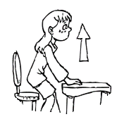{:height="80px" width="80px"} ***stand up*** / 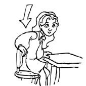{:height="80px" width="80px"} ***sit down*** / 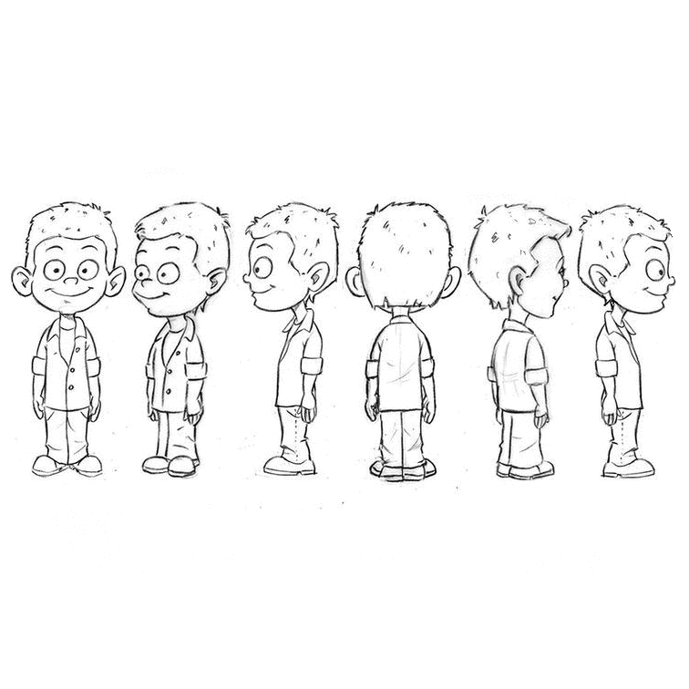{:height="80px" width="80px"} ***turn around*** /  
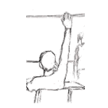{:height="80px" width="80px"} ***put*** one hand up (***put*** your hand up) / {:height="80px" width="80px"} ***jump*** /  
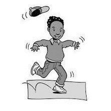{:height="80px" width="80px"} ***hop*** /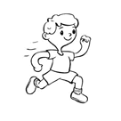{:height="80px" width="80px"} ***run*** / {:height="80px" width="80px"} ***stop***  

<!--<iframe width="220" height="124" src="https://www.youtube.com/embed/GoSq-yZcJ-4" frameborder="0" allow="accelerometer; autoplay; clipboard-write; encrypted-media; gyroscope; picture-in-picture" allowfullscreen></iframe>  
Vê o vídeo, canta e faz as acções.  [Lyrics for parents/Letra para pais](https://tangerina-pt.github.io/English/witj)   

{:height="80px" width="80px"} ***Walk***/ {:height="80px" width="80px"} ***stop*** / {:height="80px" width="80px"} ***listen***/ {:height="80px" width="80px"} ***stomp*** / {:height="80px" width="80px"} ***jump*** / {:height="80px" width="80px"} ***skip***  / {:height="80px" width="80px"} ***run***   

***Nota:*** 'SKIP' em inglês pode ser duas acções diferentes: (1). saltar a corda (também referido como 'JUMP ROPE') e (2). o sentido usado nas nossas cançóes e jogos nas aulas que como não há tradução directa é demonstrado nos seguintes vídeos:  

<iframe width="198" height="112" src="https://www.youtube.com/embed/QeZRaQXJiW0" frameborder="0" allow="accelerometer; autoplay; clipboard-write; encrypted-media; gyroscope; picture-in-picture" allowfullscreen></iframe> <iframe width="198" height="112" src="https://www.youtube.com/embed/_tzIdoCLvH8" frameborder="0" allow="accelerometer; autoplay; clipboard-write; encrypted-media; gyroscope; picture-in-picture" allowfullscreen></iframe> <iframe width="198" height="112" src="https://www.youtube.com/embed/m9MccH7mWO0" frameborder="0" allow="accelerometer; autoplay; clipboard-write; encrypted-media; gyroscope; picture-in-picture" allowfullscreen></iframe>

***Language:***
***Question:*** **'Can you clap?'; (Consegues bater palmas?)**  
***Answers:***  **'Yes, I can. I can clap.' (Sim, consigo. Consigo bater palmas)**  
**or/ou 'No, I can't. I can't clap.' (Não, não consigo. Não consigo bater palmas)**  

<iframe width="220" height="124" src="https://www.youtube.com/embed/_Ir0Mc6Qilo" title="YouTube video player" frameborder="0" allow="accelerometer; autoplay; clipboard-write; encrypted-media; gyroscope; picture-in-picture" allowfullscreen></iframe>  
[Vê o vídeo, canta e faz as acções.](https://www.youtube.com/watch?v=_Ir0Mc6Qilo)  
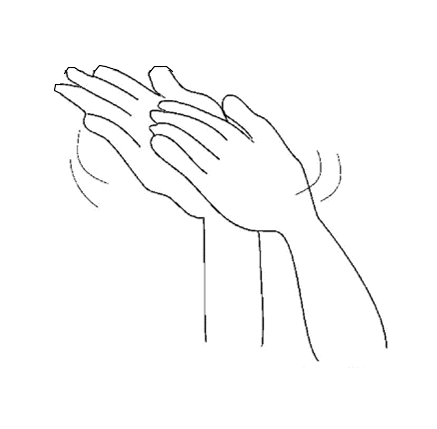{:height="80px" width="80px"} ***clap*** / 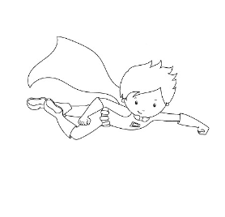{:height="80px" width="80px"} ***fly*** / 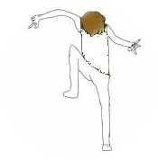{:height="80px" width="80px"} ***stomp*** / 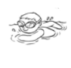{:height="80px" width="80px"} ***swim*** /  
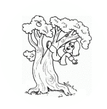{:height="80px" width="80px"} ***climb*** / {:height="80px" width="80px"} ***run*** / {:height="80px" width="80px"} ***sing*** / 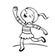{:height="80px" width="80px"} ***dance***-->  

***
[{:height="60px"}](https://tangerina-pt.github.io/English) [Return to the Tangerina English Homepage](https://tangerina-pt.github.io/English)  

***

***  
[Notes/Notas](https://tangerina-pt.github.io/English/Intro_P)  

***   
* Feedback/dúvidas re: Sing, Play, Learn English @Tangerina - c21educator@gmail.com  

  

